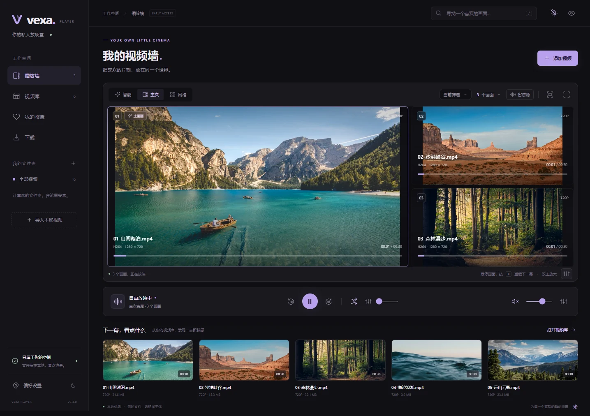
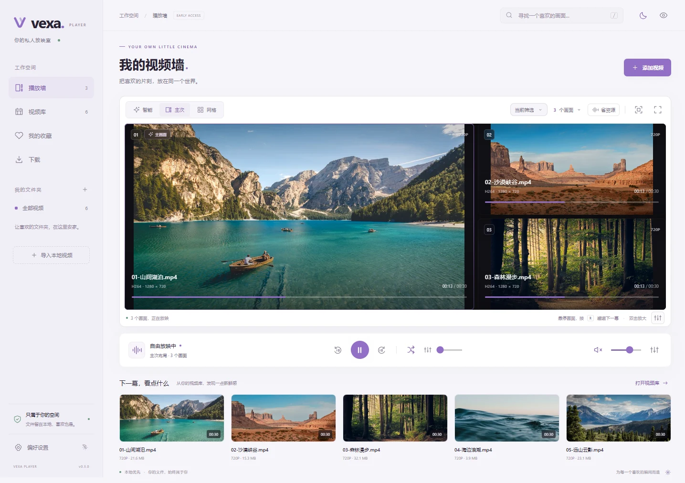
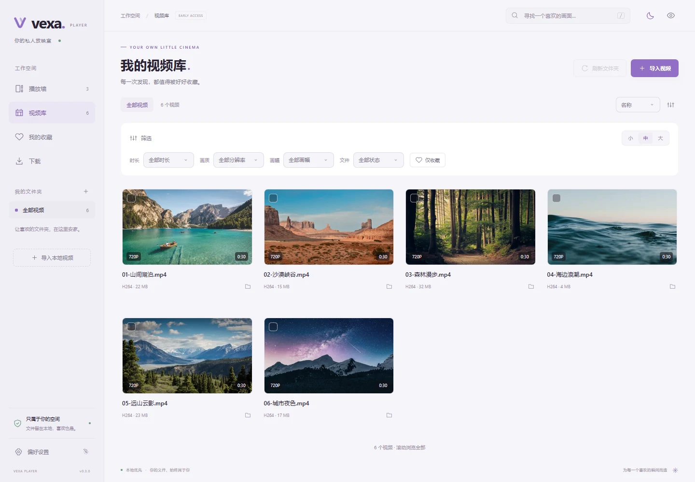
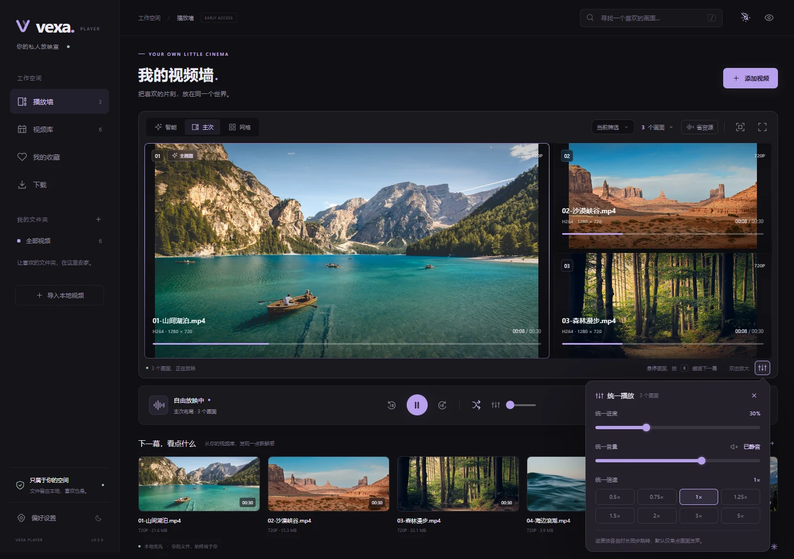
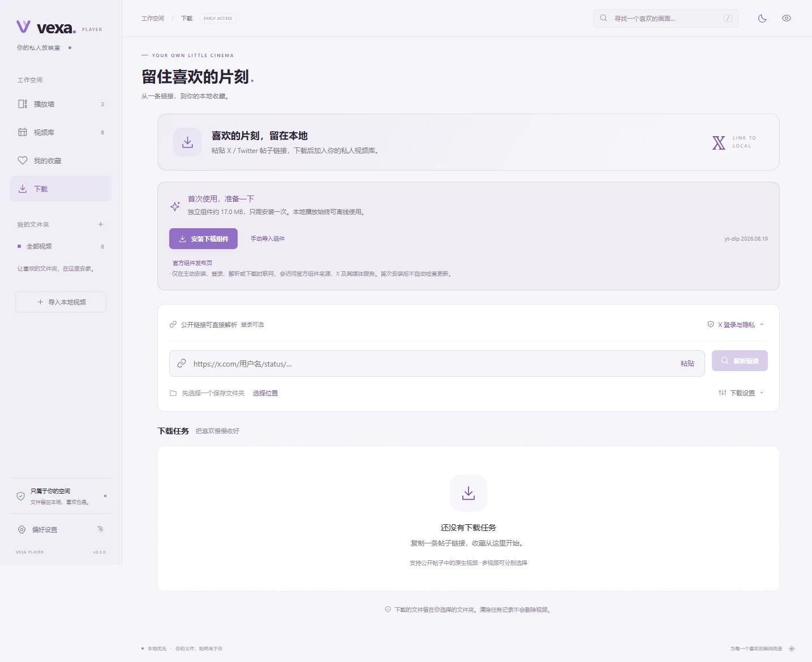
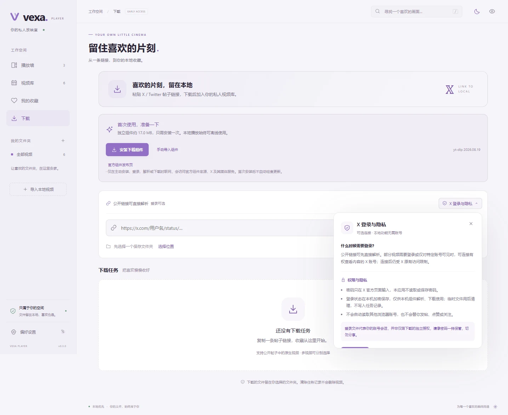

# Vexa Player

一个本地多视频播放器，本地导入与播放完全离线可用。当前版本为 **0.3.0 开发版**：从本地文件/文件夹导入，建立 SQLite 视频库，创建最多 32 个画面的播放墙；另提供用户主动使用的 X 链接下载功能。

**下载安装：[Windows x64 安装包（v0.3.0）](https://github.com/lengziyu/vexa-player/releases/download/v0.3.0/Vexa-Player-0.3.0-Windows-x64.exe)** · [发布页与校验文件](https://github.com/lengziyu/vexa-player/releases/tag/v0.3.0)

下载 `.exe` 后运行安装即可。当前提供 Windows 64 位开发版；macOS 安装包尚未发布。

当前 Windows 安装包约 **127 MiB**，比 v0.2.0 缩小约 **20.4%**，安装后占用减少约 90 MiB，保留离线导入、封面生成和播放能力。体积对比与检查记录见[自测报告](docs/SELF_TEST.md)。

## 界面与操作演示

以下截图与录屏来自 **v0.3.0 Windows 实际程序**，使用独立演示视频库。安装后的应用不自带示例视频，导入自己的视频即可开始使用。

**全屏操作动图（节选）** · 四画面播放 → 主次 / 网格切换 → 双击放大 → 随机换片。


[▶ 查看完整 1080P / 30fps 全屏录屏](docs/media/vexa-demo.mp4)。完整视频还展示拖动交换、六画面播放、统一进度与倍速，以及控件自动隐藏和鼠标唤醒。

**深色播放墙** · 多个视频同时播放，支持主次、网格与智能布局。



<details>
<summary>展开更多截图：全屏播放、浅色主题、视频库、统一控制与 X 下载</summary>

**全屏四画面** · 视频铺开显示，静止时自动隐藏工具栏。


**双击放大** · 在播放墙内放大单个视频，再双击恢复原布局。


**浅色播放墙** · 清爽的浅紫色调，播放布局和操作保持一致。



**视频库** · 缩略图预览、组合筛选、多选建墙。



**统一控制** · 按钮旁展开小面板，集中调整进度、音量与倍速，支持 3× / 5×。



**X 视频下载** · 粘贴帖子链接，按需安装下载组件；公开链接可先直接解析。



**可选登录与隐私说明** · 需要时再连接 X，面板内说明访问限制、账号会话权限与本机保存方式。



</details>

## 已接通的功能

- 深色、浅色、跟随系统，三种强调色；选择保存在本机，重启生效。
- 文件/文件夹选择、文件拖入、可选递归、后台扫描、取消与刷新。
- FFprobe 信息读取、FFmpeg 封面、收藏、搜索、排序；时长、分辨率、横竖屏、文件状态和收藏可组合筛选。
- 视频库虚拟滚动、按需读取与有限页缓存，支持跨页 Shift 多选和对全部筛选结果全选；缩略图三档大小保存到本机。
- 真实视频播放、主次/智能/网格布局、拖拽交换、主画面、双击放大、全屏。
- 独立播放/进度/音量/倍速/循环，统一暂停、静音、相对和百分比跳转。
- 视频进度条悬停加粗并扩大拖动区域；全屏播放静止约 2.8 秒后隐藏控件和鼠标，移动或键盘操作唤醒。
- “双击放大”旁的调节图标向下展开统一进度、音量和倍速面板；全屏时保持视频大小，支持点外部或 Esc 收起。
- 画面锁定、随机替换、随机起播、结束和定时换片。
- 持续解码掉帧提示、一键暂停非主画面；可选“放大时暂停其他画面”，恢复时保留手动暂停状态。
- 最多 32 路播放，16 路起提供资源提醒；单画面与统一控制均支持 3×、5× 倍速。
- 倍速、排序、筛选和画质选择使用主题一致的自定义菜单，支持键盘、全屏与减少动效。
- X / Twitter 单条原生视频链接解析、指定画质下载、队列取消重试和完成后入库；可选登录面板说明权限与隐私。
- 安全首页、隐藏并静音（最小化到任务栏）、恢复后保持暂停、封面缓存开关与清理。
- 默认不记录观看历史，不上传文件，不修改原视频。

## 启动

要求 Node.js 22.12+ 或 24+，推荐 Node.js 24 LTS。

```powershell
npm ci
npm run dev
```

如果包管理器提示下载脚本未运行，执行对应工具的安装脚本后再启动：

```powershell
node node_modules/electron/install.js
node node_modules/ffmpeg-static/install.js
```

只看界面：`npm run dev:web`。浏览器模式不冒充桌面导入能力；真实文件夹扫描与持久化请启动桌面版。

## X 视频下载

本地试用可双击项目根目录的 `启动本地测试.cmd`，或运行 `npm run test:local`。会编译并打开本地应用，不生成安装包；测试偏好和视频库独立保存在 `.cache/local-test-profile`，不占用已安装版本的数据目录。首次打开为空视频库，需要主动导入或下载视频；在下载页选择保存位置后，完成的视频会写入该位置。

运行 `npm run dev` 后打开左侧“下载”：首次安装下载组件，选择保存位置，粘贴 `https://x.com/.../status/...` 或 Twitter 帖子链接并解析。多视频帖子可以分别勾选，支持最高可用画质或指定分辨率；后台单并发排队，可取消、重试、定位文件。默认完成后加入视频库，不自动播放。

“下载设置”可选择跟随系统代理、直连或手动 HTTP(S)/SOCKS5 代理，并关闭自动入库。暂不支持需要账号密码的代理。系统代理无法解析时会提示手动配置，不要求用户修改本地视频播放设置。

组件使用官方 yt-dlp `2026.08.19`，首次下载 Windows x64 组件约 17 MiB，固定 SHA-256 校验，不自动检查更新；也可通过页面上的官方发布页下载指定版本后手动导入。复用现有 FFmpeg/FFprobe，不另装 Python 或第二套媒体工具。未主动安装、登录、解析或下载时不发起下载功能的网络请求。

公开链接可先直接解析，应用本地功能无需账号。需要账号访问的视频可点击“X 登录与隐私”，在按钮旁的小面板中查看访问限制、权限与隐私说明，再主动选择“连接 X”。面板里的“使用浏览器或登录文件”支持打开官方登录页和导入已登录浏览器导出的 Netscape Cookie 文件，不会自动读取其他浏览器账号。

只使用 X 的 `auth_token` / `ct0`，登录状态用系统安全存储加密保存，解析/下载时短暂生成专用 Cookie 文件，命令结束后删除。“断开并清除登录”清除本应用保存的状态，自行导出的原始文件需另行删除。登录文件代表账号会话，并非只授予下载权限；不要将它发送到聊天或交给他人。

解析器报告“未找到视频”并不能证明帖子没有视频；应用会对这类歧义失败尝试一次备用接口，再提示可能需要登录、访问受限或兼容问题。登录后仍以账号实际访问权限及解析结果为准，不承诺所有帖子可下载。

暂不支持短链接、主页/整账号批量下载、直播和外站视频。任务记录仅保留在当前会话；取消或正常退出会停止对应进程并清理当前任务未完成文件，已完成的视频保留。异常断电留下的 `.vexa-downloads` 临时目录不会进入视频库，可在退出应用后手工清理。跨重启续传、保存下载记录留待后续。

清除下载记录不会删除最终视频；下载成功但入库失败时可单独重试入库。首轮真实网络验证与支持限制见 [X 下载自测记录](docs/X_DOWNLOAD_TEST.md)。

## 主题与快捷操作

右上角太阳/月亮一键切换浅色/深色；“偏好设置 → 外观”还可选择跟随系统。主题、强调色、减少动效分别设置。

| 快捷键 | 操作 |
| --- | --- |
| Space | 全部播放/暂停 |
| K | 焦点画面播放/暂停 |
| R | 替换鼠标悬停的未锁定画面 |
| M | 全局静音 |
| 左/右 | 焦点画面后退/前进 10 秒 |
| F | 全屏播放墙 |
| Esc | 关闭弹窗或退出聚焦放大 |
| Ctrl/Cmd + Shift + H | 隐藏并静音 |
| / | 搜索 |

导入只创建索引，不自动播放。视频库多选后点击“创建播放墙”；双击单个库条目或点击“加入播放墙”可追加。默认只允许焦点画面发声，初始全局静音。

筛选区支持多条件叠加，随机候选选择“当前范围”时沿用相同条件。分辨率按短边计算，例如 1080×1920 归入 1080P。文件“读取正常”表示元信息已读取，实际解码能力仍以播放结果为准。Ctrl/Cmd+A 选择全部匹配视频，当前开发版播放墙最多接收 32 个，超量时保留选择并提示，不截断已有画面。

播放墙底部“双击放大”旁的调节按钮打开小面板：进度按各视频时长的相同百分比跳转，总音量保留单画面的音量和静音选择，统一倍速作用于现有画面并用于之后新加入的画面。单独调整倍速后会显示“不同倍速”。调整进度或倍速不会自动播放已暂停的画面；音量从零调高会解除全局静音。

独立与统一倍速均支持 0.5×、0.75×、1×、1.25×、1.5×、2×、3×、5×。数量菜单增加 20、24、28、32 路；从 16 路开始显示轻量资源提示，可主动开启“省资源”，不会弹出确认框或自动暂停。全屏静止时提示随控件隐藏，实际持续掉帧时优先显示测得的掉帧提示。

全屏控件在展开面板、拖动滑块或使用键盘聚焦按钮时保持显示，暂停时也会显示。展开面板不会遮罩整个页面，点外部或按 Esc 可收起。

播放墙工具栏的“省资源”只保留列表中第一个主画面继续播放，再次点击恢复此前正在播放的其他画面。偏好设置可开启放大时暂停其他画面；手动暂停和隐私隐藏不会被自动恢复覆盖。掉帧提示基于播放器实际计数连续三个有效采样窗口超过 5%，不代表 CPU/GPU 占用测量。

## 自测与构建

```powershell
npm run typecheck
npm test
npm run test:desktop
npm run test:downloads
npm run test:x-auth
npm run test:capacity
npm run pack
npm run dist:win
npm run test:package
```

桌面测试使用生成的真实 H.264/AAC 视频与独立临时数据目录，不访问用户的视频库。检查记录输出到 `test-results/desktop-results.json`，截图输出到 `docs/screenshots/`。短时多路测试不代替真实收藏视频与不同显卡上的长期性能验收。

`test:downloads` 为显式联网测试：在独立临时目录安装官方组件，解析公开 X 样本并下载、入库和播放；不会访问用户视频库，测试结束清理样本。输出 `test-results/downloads-results.json`。设置 `VEXA_TEST_EXECUTABLE` 可复测安装包内的实际程序；打包结果见[自测报告](docs/SELF_TEST.md)。

Windows 安装包输出到 `release/<版本号>/`。macOS 应在对应架构的 Mac 或 CI 中独立安装依赖后执行 `npm run dist:mac`；Intel 与 Apple Silicon 分别构建、运行并验证 FFmpeg/FFprobe 的架构，不能直接复用 Windows 的 node_modules。签名与公证需要发布者自己的凭据。

## 支持边界

当前播放内核为可替换的 HTML5 Video。识别 MP4/MKV 等文件不等于其中全部编码都能播放；遇到不支持的组合会在对应画面提示。libmpv/libVLC 尚未接入。macOS、HEVC/AV1/HDR、长时间高负载与不同 GPU 的支持状态见 [自测报告](docs/SELF_TEST.md)。

当前以中文界面完成核心闭环。英文界面、按编码/帧率等更多属性筛选、完整自动性能降级、长期压力验收与需求第二/三阶段功能仍需后续开发；不将本开发版标为完整首发验收通过。

原始 UI 概念稿保留在 `ui-preview/`。正式应用不加载其中的示例库或照片。

详细信息：[功能需求](需求.md) · [架构设计](docs/ARCHITECTURE.md) · [第三方说明](docs/THIRD_PARTY_NOTICES.md)
